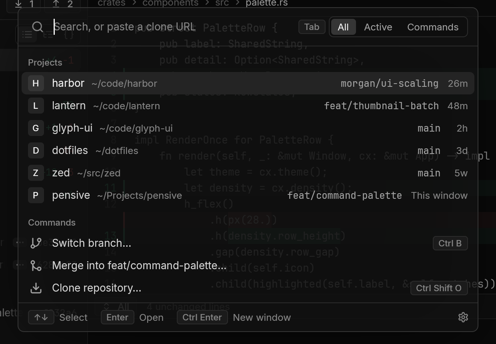
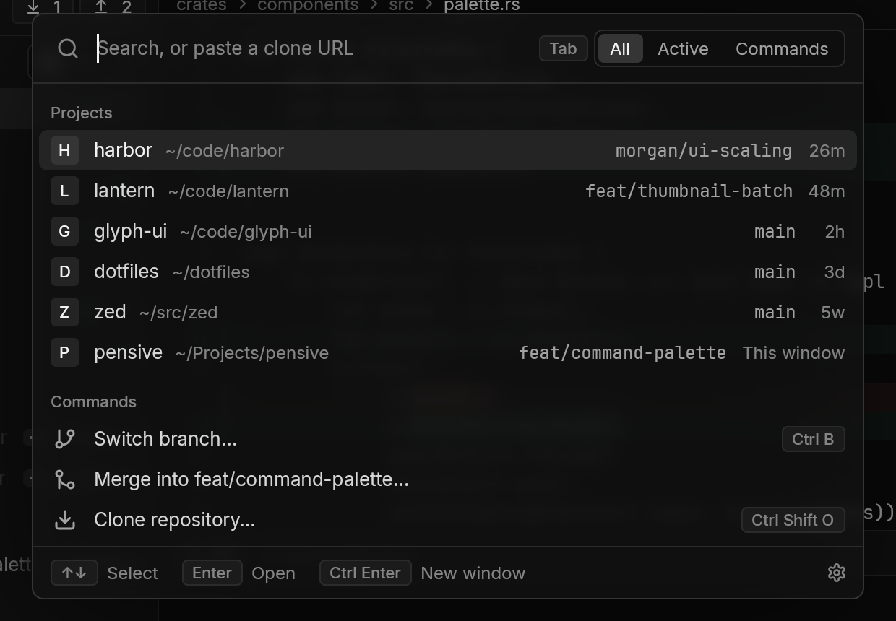
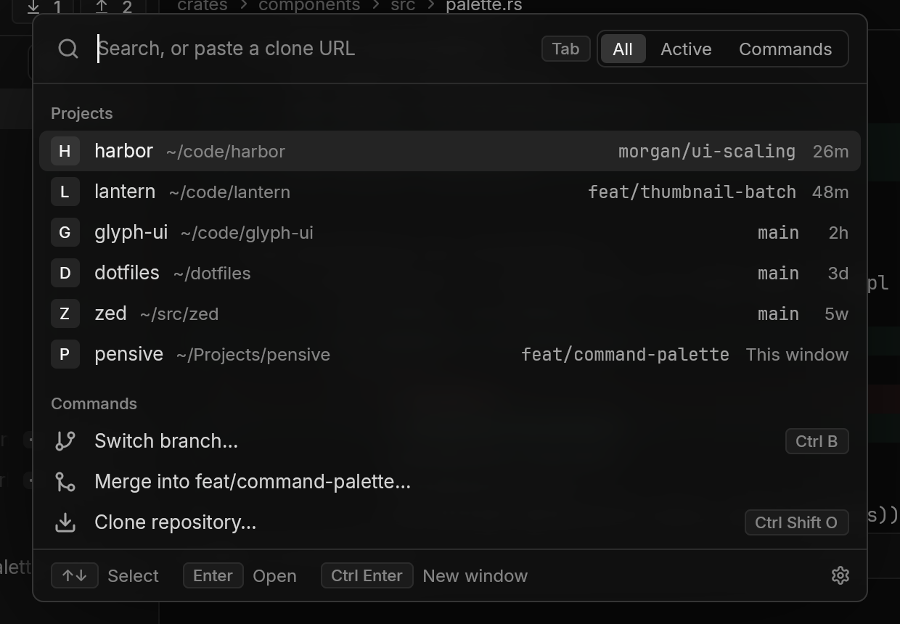

# Overlay blur

Decided in PEN-26. Covers whether the command palette, and later other overlays, can blur the window behind them, what each way of doing it costs, and what Pensive does instead. GPUI paths are in Zed's repo at v1.27.0, the tag we pin, under `crates/`. Upstream pull requests were checked on GitHub in November 2026.

Blur would make a translucent palette readable while keeping the color of what's behind it, which is the glass look. GPUI can't do it today, and every way to add it means patching GPUI, which for us means a fork. We judge that not worth it for now, so Pensive keeps opacity and scrim as its backdrop settings. Whether the look is worth more than that is a design call, left open at the end of this doc.

## Feasible on Linux, macOS and Windows?

For a blur pass in GPUI's renderers (option 1):

- Linux: yes, in the wgpu renderer. The lowest risk, and the same code covers the browser and every mock.
- macOS: yes, in the Metal renderer. Release builds need the frame drawn to an offscreen texture first.
- Windows: yes, in the DirectX 11 renderer. Copying the frame out already works, but no mock covers this renderer.

All three need a patched GPUI. The options below cover the cost, and the alternatives.

## How GPUI draws a frame

Each frame, elements paint into a `Scene`: flat lists of primitives, one list per kind (`gpui/src/scene.rs:41-53`). There are eight kinds: quads, shadows, paths, underlines, three kinds of sprite (glyphs and images), and surfaces (`scene.rs:222-231`). Each primitive gets an order number from a spatial tree, so a primitive that overlaps an earlier one sorts after it (`scene.rs:87-100`, `gpui/src/bounds_tree.rs:13-19`). The renderer walks the lists in that order as batches (`scene.rs:172`, `scene.rs:477-496`) and draws them into the window's frame texture in one pass. It clears the frame first and redraws the whole window every time it presents (`gpui_wgpu/src/wgpu_renderer.rs:1503-1515`).

A blur behind an element, like CSS `backdrop-filter`, needs something that pass never does: stop partway through the frame, read back what's drawn under the element so far, blur it, and draw it back inside the element's rounded rect before the element's own fill.

## What GPUI has

**No blur inside a window.** No primitive reads what's already drawn. `Window`'s paint methods cover quads, shadows, paths, underlines, glyphs, SVGs, images and surfaces (`gpui/src/window.rs:4579-5201`). A fill is a solid color, a linear gradient, a slash pattern or a checkerboard (`gpui/src/color.rs:745-750`). The only blur in the shaders is the one on box shadows, which computes a blurred rectangle's edge from a formula and never samples pixels (`gpui_wgpu/src/shaders.wgsl:985-1021`, `gpui_apple/src/shaders.metal:476-540`, `gpui_windows/src/shaders.hlsl:894-930`).

**No way for Pensive to add a live blur.** The primitive list is a closed enum in `gpui`, and each platform's window builds its own renderer, so an app can't add a primitive or a render pass. Surfaces look like a way in, but they carry macOS video frames and the wgpu renderer skips them (`wgpu_renderer.rs:1606-1608`). The nearest an app gets is a still copy of the window: read the frame back, blur it on the CPU, and paint it as an image (option 5).

**Blur behind the whole window.** `WindowBackgroundAppearance::Blurred` asks the OS compositor to blur what's behind the window, and GPUI's own comment says "Not always supported" (`gpui/src/platform.rs:2894-2898`).

| Platform | How | Where |
|---|---|---|
| macOS | An `NSVisualEffectView` behind the Metal layer, blending what's behind the window | `gpui_macos/src/window.rs:1849-1868`, `3836-3852` |
| Windows | `SetWindowCompositionAttribute` with the acrylic accent, an undocumented `user32` export looked up at runtime | `gpui_windows/src/window.rs:929-931`, `1640-1670` |
| Wayland | KDE's `org_kde_kwin_blur`, only when the compositor offers it | `gpui_linux/src/linux/wayland/window.rs:2322-2335`, `wayland/client.rs:306` |
| X11 | None. The value only turns on transparency | `gpui_linux/src/linux/x11/window.rs:296-299`, `1625-1629` |
| Browser | None | |

GNOME's compositor doesn't offer `org_kde_kwin_blur`, so on GNOME `Blurred` is plain transparency. Window-level blur has also broken on a new OS release: on macOS 27 the material GPUI used stopped blurring ([#64284](https://github.com/zed-industries/zed/issues/64284)), fixed in [#65361](https://github.com/zed-industries/zed/pull/65361) by switching materials (`gpui_macos/src/window.rs:3844-3848`).

Zed uses only the window-level blur. A theme picks the window's appearance, and `theme_is_transparent` tells Zed's panels to drop their own fill so the desktop shows through (`ui/src/styles/appearance.rs:13-21`). Nothing in Zed blurs inside a window.

## Upstream

There's one open discussion and three attempts, none merged.

| | What | Outcome |
|---|---|---|
| [Discussion #47429](https://github.com/zed-industries/zed/discussions/47429), January 2026 | "Backdrop Blur for GPUI", offering a fork's patch | Open. One reply, from a contributor who isn't Zed staff, explaining why GPUI can't do it and suggesting the macOS `BlurredView` be scoped to an element's bounds |
| [#54512](https://github.com/zed-industries/zed/pull/54512), April 2026 | Blur and "liquid glass" primitives for wgpu and Metal, a stub for DirectX | Withdrawn by its author 5 minutes after opening, to keep it in their fork. Never reviewed. About 2,000 of its 13,054 added lines are rendering. The rest is unrelated dev container, Docker and git graph code |
| [#59026](https://github.com/zed-industries/zed/pull/59026), June 2026 | A backdrop blur primitive, DirectX only | Closed the next day by a contributor who isn't listed as Zed staff, citing no staff buy-in and only one backend. About 800 lines of scene and renderer code, plus a 568-line example and 200 lines of tests |
| [#63773](https://github.com/zed-industries/zed/pull/63773) and the PRs stacked on it, September 2026 | Effect layers: CSS `filter`, `backdrop-filter`, masks and blend modes, for all three renderers | Closed by a Zed staff member about 8 hours after opening, with no comment. 4,029 lines for the core and three renderers, on top of 1,423 lines of prerequisites |

Zed's contributing guide asks for a discussion and staff confirmation before a feature PR (`CONTRIBUTING.md:11-12`). None of these has that confirmation, and no Zed staff member has commented on any of them, so waiting for upstream has no date.

Forks carry versions of it: #54512's author moved theirs to a fork, and #63773 is the same change as one in the `remorses/zed` fork. One fork is on crates.io, [`gpui-box`](https://crates.io/crates/gpui-box), with a `Window::paint_backdrop_blur`. Both its releases came out on one day in August 2026, before v1.27.0, and it hasn't changed since. Using it would mean swapping all of GPUI for a third party's snapshot, so it doesn't count as an upstream path.

## Options

### 1. A backdrop blur pass in GPUI

What it takes:

- In `gpui`, a backdrop primitive with bounds, corner radii, clip and radius, its own batch kind, a `Window::paint_backdrop_blur`, and a `backdrop_blur` style that a `div` paints before its fill. The primitive has to take its order with its bounds grown by three times the blur radius. The spatial tree then sorts it after everything the blur samples, including content just outside the element.
- In each renderer, at a backdrop batch: end the pass, copy the region under it, blur it at reduced size, start a new pass that keeps what's drawn, and draw the blurred copy through the rounded rect. Paths already split the pass this way to draw into a side texture (`wgpu_renderer.rs:1532-1566`, `gpui_apple/src/metal_renderer.rs:807-830`, `gpui_windows/src/directx_renderer.rs:372-375`), so the structure exists.
- Shaders in three languages: WGSL (plus the WebGL variant in `gpui_wgpu/src/shaders_webgl.wgsl`), Metal and HLSL.

The hard part differs per renderer, because none of them can read the frame texture as it's set up today.

| Renderer | Used for | The catch | Risk |
|---|---|---|---|
| wgpu | Linux, the browser, every mock | The swapchain texture only allows drawing into it (`wgpu_renderer.rs:453-455`). Not every surface allows copying from it either, so frames with a backdrop would draw into an offscreen texture and copy that to the screen at the end. The headless target mocks use can already be copied (`wgpu_renderer.rs:2370`) | Low. One code path, and mocks check it |
| Metal | macOS | The drawable is framebuffer-only. GPUI turns that off only in debug test builds, because it costs presentation (`metal_renderer.rs:207-211`). Release builds would need the offscreen texture too | Medium. Needs a Mac to check |
| DirectX 11 | Windows | The swapchain buffers are render targets, not shader inputs (`directx_renderer.rs:1313`, `1342`). Copying out is easy: GPUI already copies the back buffer for screenshots (`directx_renderer.rs:431-457`) | Medium. Needs a Windows machine, and no mock covers this renderer (PEN-24) |

Mocks would show the blur on Linux and Windows, which render mocks with wgpu (`crates/mock/src/lib.rs:152-159`), and on macOS, where the headless Metal renderer shares the window's draw code (`metal_renderer.rs:636`, `772`).

Size. The attempts above give the scale. #59026's core and DirectX code is about 800 lines. #54512's blur for wgpu and Metal is about 2,000, including a lens effect. The #63773 stack's effect layers come to 661 lines in the core, 1,031 for Metal, 1,323 for wgpu and 1,024 for DirectX, but they also do content blur, color matrices, masks and blend modes. A backdrop blur alone for all three renderers should land between 2,000 and 3,500 lines. The time is a guess, not a measurement: 3 to 5 days for the core and wgpu, 2 to 3 days each for Metal and DirectX, plus testing on real Macs and Windows machines.

Upkeep. Until Zed takes the feature, it means a fork: all four of our Zed dependencies point at it, and every GPUI upgrade rebases the patch. The files it touches change often. In the six months to November 2026, `scene.rs` had 12 upstream commits, `wgpu_renderer.rs` 14, `metal_renderer.rs` 16 and `directx_renderer.rs` 12.

Performance, estimated from pixel counts and not measured. The palette is 576 dp wide (`crates/components/src/command_palette/mod.rs:329`) and about 400 dp tall with results. At 2x scale with a 16 dp blur, the region to copy is about 1,350 by 1,000 pixels. Blurring at reduced size adds about a third more work, which totals about one full-window copy at 1080p. That should cost well under a millisecond on a laptop GPU. It runs on every frame GPUI presents while the palette is open. Frames come from typing and hover, and from the toast's draining line, which requests a new frame on every frame while a toast counts down (`crates/ui/src/notices.rs:272-274`). The renderer can't cache the blur, because it gets a fresh scene each frame with no record of what changed under the palette. One palette can afford this. Blur on every tooltip and menu would multiply it.

### 2. The palette as its own window

Open the palette in a separate transparent window with `Blurred`, and let the OS compositor blur the main window underneath it.

- Blur only works where `Blurred` works: macOS, Windows and KDE. GNOME, X11 and the browser get plain transparency.
- Wayland doesn't let an app place its own top-level windows. GPUI's anchored popups can be placed relative to a parent, but only on Wayland. macOS, Windows and X11 reject them (`gpui_macos/src/platform.rs:750-754`, `gpui_windows/src/window.rs:443-447`, `gpui_linux/src/linux/x11/window.rs:477-481`).
- Keyboard focus moves to another window, so Pensive's title bar shows the main window as inactive while the palette is open. The palette also has to follow the main window when it moves or resizes, and the scrim (in the main window) and the palette (in its own) fade in separately.
- Mocks can't show it. The headless renderer draws one window into an opaque target (`wgpu_renderer.rs:2323-2326`), and the blur only happens later, in the OS compositor.

This option rewrites how the palette behaves as a window to get blur on half the platforms, with no mocks of it.

### 3. Fake glass without blur

What blur keeps is the color and tone of what's behind, with none of its detail. Nothing GPUI can draw over the fill does that without reading the pixels under it.

- Higher opacity hides detail, but it hides color with it, and the palette stops being translucent.
- A grain texture, a bundled noise image painted over the fill at low alpha, since GPUI has no noise fill (`color.rs:745-750`). It adds texture but keeps the edges of the text behind.
- A tinted fill with a gradient sheen (`color.rs:865`) and a lighter top border reads as a material, with the same text showing through it.

I didn't render the last two. They follow from the first: anything drawn over the fill without reading the pixels under it leaves their edges in place. These are cheap, a few hours in `components`, and they'd show in mocks everywhere, but none of them makes a translucent palette readable.

### 4. Opacity and scrim only

What ships today (PEN-31). Opacity defaults to 100% and scrim to 50%, so by default nothing shows through the palette at all.

### 5. A snapshot, blurred on the CPU, painted as an image

Take a still copy of the window when the palette opens, blur it on the CPU, and paint it under the palette's fill. The parts exist:

- `Window::render_to_image` renders the last frame's scene again and reads it back as an RGBA image (`gpui/src/window.rs:2912-2919`).
- `RenderImage::new` wraps those pixels as an image (`gpui/src/assets.rs:61`), and `Window::paint_image` paints it (`window.rs:5099`), from a `canvas` element placed under the palette's fill.
- The blur runs on GPUI's background executor, as plain Rust over the pixels.

A modal palette is the best case for a still image. The frame on screen when the palette opens is exactly what's behind it, and the window under the palette rarely changes while it's open.

The gaps:

- `render_to_image` only exists with GPUI's `test-support` feature (`window.rs:2915`). That feature also pulls in proptest and test-only versions of other crates (`gpui/Cargo.toml:22-31`). Pensive turns it on only for tests and mocks.
- Linux and the browser have no readback for a real window. The X11, Wayland and browser windows don't implement it, so they get the default that returns an error (`gpui/src/platform.rs:1456-1459`).
- macOS reads the drawable it just rendered (`gpui_apple/src/metal_renderer.rs:636-657`). That only works where the drawable isn't framebuffer-only, which is debug test builds (`metal_renderer.rs:207-211`), so release builds can't use it.
- Windows works. It renders again and copies the back buffer (`gpui_windows/src/window.rs:1044-1050`, `directx_renderer.rs:413-457`).
- Opening the palette, a keyboard path people hit all day, gains a second full render, a wait for the GPU, a copy to the CPU and the blur. Unmeasured.
- The copy goes stale. A window resize needs a new one, and anything under the palette that changes while it's open, such as a toast sliding in near its edge or a file reloading in the editor, stays frozen in the blur.

Mocks could show it: the headless window that mocks render with implements `render_to_image` (`gpui/src/platform/test/window.rs:572-582`).

This still needs a GPUI patch for Linux and macOS, but a smaller one than option 1: no shaders, and no change to how frames draw. It's readback through an offscreen texture, which the headless renderers already do (`wgpu_renderer.rs:2370`, `2430-2445`, and `render_scene_to_image` at `metal_renderer.rs:664`). Asking Zed to let an app read back its window outside tests is also a much smaller request than blur.

## Prototype

To see what blur would look like on Pensive, I simulated it without changing GPUI, on a throwaway local branch.

Method:

- The `root/palette` mock: the sample `pensive` project with a diff open in the editor, a 960 by 640 dp window rendered at 2x, the dark theme. Pensive ships no other theme, so only dark was tried.
- Palette opacity 70%, scrim 25%. Then the same mock with the scrim replaced by opaque black, and again by opaque white. Those two give the palette's color and coverage at every pixel.
- The window without the palette (`root/project`), dimmed by 25% for the scrim, then blurred with ffmpeg's Gaussian blur. The radius is the Gaussian's standard deviation, the same meaning CSS `blur()` gives it: 8 dp and 16 dp, so 16 and 32 pixels at 2x. The scrim is under the palette, so the blur includes it. A uniform 25% dimming comes out the same blurred before or after.
- The blurred copy only fills the palette's rounded rect. Outside it, the window stays sharp, and the palette's own shadow isn't blurred.
- To check the method, compositing over the unblurred window reproduces GPUI's own render at 52.7 dB PSNR, a measure of how close two images are. At that level they differ by at most a step or two in 8-bit color.

70% opacity, no blur. The code in the editor is readable through the palette and competes with its rows:

70% opacity with an 8 dp blur, simulated. The code behind is gone and the rows read cleanly. What's left is a dark wash with faint green and red where diff lines sit:

16 dp looks nearly the same, because the window behind is mostly gray:

So blur buys a readable translucent palette that keeps a hint of the color behind it. We judge that not worth 2,000 to 3,500 lines and a fork of GPUI's renderers today.

## Recommendation

1. Keep opacity and scrim as the palette's backdrop settings, with 100% opacity as the default. Build no blur now.
2. Don't add a fake glass treatment. None of the cheap versions makes a translucent palette readable.
3. Rule out option 2.
4. If the glass look is wanted, try option 5 first: its GPUI change is readback, with no rendering changes, and it's a small enough request to raise with Zed as a discussion. Option 1, starting with wgpu, is the route if the backdrop has to stay live while the palette is open.

## Open question

Is the look in the 8 dp image worth a GPUI patch? This doc recommends no for now, but it's a design call, so it's yours to approve or overturn.
